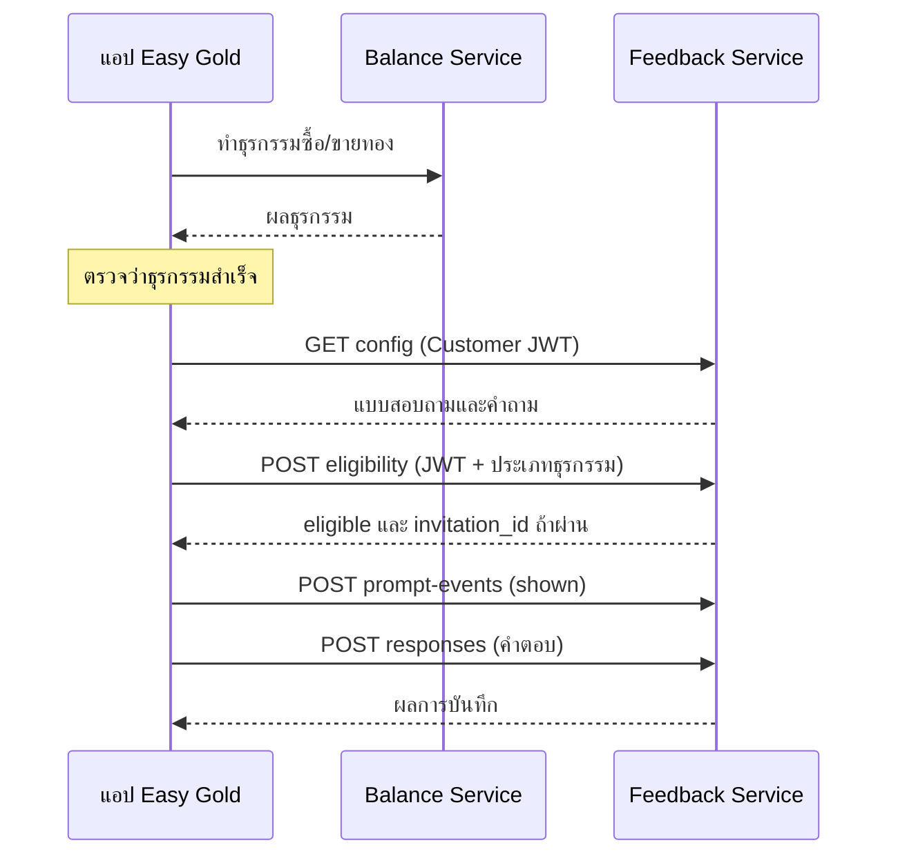

# คู่มือ API สำหรับแอป Easy Gold → Feedback Service

เอกสารนี้อธิบาย customer API ที่มีอยู่ใน Feedback Service สำหรับแอปมือถือ เรียก Feedback Service โดยตรง ไม่ผ่าน Feedback API ของ Balance Service โค้ด Flutter ยังต้องเชื่อมต่อ API เหล่านี้ก่อนใช้งานในแอปจริง

## 1. ภาพรวม



Feedback Service บันทึกประเภทและข้อมูลธุรกรรมที่ **แอปรายงาน** และไม่ตรวจสอบสถานะธุรกรรมหรือเจ้าของธุรกรรมกับ Balance ตาม flow ที่เลือก ดังนั้นข้อมูลธุรกรรมอาจถูกปลอมแปลงได้ แม้ JWT จะยืนยันตัวผู้ใช้แล้ว

## 2. Base URL และการยืนยันตัวตน

ตัวอย่างสำหรับทดสอบบน Mac ที่เปิดบริการอยู่ขณะจัดทำเอกสาร:

```text
http://192.168.100.46:8001/api/v1/feedback
```

IP อาจเปลี่ยนเมื่อเปลี่ยนเครือข่าย เครื่องที่เรียกต้องเข้าถึง Mac ได้ ใช้ URL ของ environment ที่ถูกต้องสำหรับระบบอื่น ค่า `127.0.0.1` บนอุปกรณ์เพื่อนหมายถึงเครื่องของเพื่อน ไม่ใช่ Mac เครื่องนี้

ทุก request ต้องส่ง customer JWT เดิม:

```http
Authorization: Bearer <CUSTOMER_JWT>
Accept: application/json
```

ทุก POST ให้เพิ่ม:

```http
Content-Type: application/json
Idempotency-Key: <unique-key-for-this-operation>
```

Feedback Service ตรวจ JWT และอ่าน user ID จาก claim `_id` และตรวจว่า role เป็น `CUSTOMER` ไม่ต้องส่ง `actor_user_id` หรือ service token จากแอป ค่า user ID ใน body ไม่ถูกนำมาใช้แทน JWT

ฝั่งเซิร์ฟเวอร์ต้องตั้ง `FEEDBACK_CUSTOMER_JWT_SECRET` ให้ตรวจลายเซ็น JWT ของระบบเดิมได้ โดยไม่ใส่ secret หรือ service token ไว้ในแอป ค่า local ตั้งไว้แล้วบน Mac แต่ environment อื่นต้องตั้งแยก การใช้ HS256 หมายความว่า service ที่ถือ secret นี้สามารถสร้าง JWT ได้ด้วย จึงต้องจัดการ secret อย่างเหมาะสม

**Idempotency:** การ retry operation เดิมให้ใช้ key และ payload เดิม การสร้าง operation ใหม่ให้ใช้ key ใหม่ แยก key ของ eligibility, event และ response ออกจากกัน Key ใช้อักษร ตัวเลข `.`, `_`, `:`, `-` ได้ ความยาว 1–128 ตัวอักษร หากใช้ key เดิมกับ payload ต่างกันอาจได้ `409 Conflict`

วันที่และเวลาที่ส่งใน body ใช้ UTC รูปแบบ `YYYY-MM-DDTHH:mm:ssZ` ไม่มีเศษวินาที และไม่อยู่ในอนาคต ตัวอย่างเวลาในเอกสารเป็นเพียงตัวอย่าง ต้องเปลี่ยนให้ตรงกับเหตุการณ์จริง

## 3. สรุป endpoints

| Method | Path | หน้าที่ |
|---|---|---|
| GET | `/config` | ดึงคำถามและการตั้งค่าของ survey ที่เผยแพร่แล้ว |
| POST | `/eligibility` | ตรวจนโยบาย Pop-up และสร้าง invitation เมื่อผ่านเงื่อนไข |
| POST | `/prompt-events` | บันทึกว่าแสดงหรือปิด Pop-up |
| POST | `/responses` | บันทึกคำตอบจาก Pop-up หรือหน้า Feedback |

## 4. GET `/config`

ใช้ก่อนแสดง Pop-up หรือหน้า Feedback เพื่อดึงคำถามจริงจาก survey ที่เผยแพร่แล้ว

| Query | จำเป็น | คำอธิบาย |
|---|---|---|
| `survey_code` | ใช่ | รหัส survey ที่เผยแพร่แล้ว ใน local ปัจจุบันมี `demo-experience` ซึ่งเป็นข้อมูลตัวอย่าง |
| `source` | ไม่ | `auto_prompt` สำหรับ Pop-up หรือ `always_on` สำหรับหน้า Feedback; ถ้าไม่ส่งจะใช้ `always_on` |

```http
GET /api/v1/feedback/config?survey_code=demo-experience&source=auto_prompt
Authorization: Bearer <CUSTOMER_JWT>
Accept: application/json
```

ตัวอย่าง response บางส่วน; ฟิลด์และคำถามจริงขึ้นอยู่กับ survey และ rules ที่เผยแพร่:

```json
{
  "source": "auto_prompt",
  "survey_code": "demo-experience",
  "survey_version": 1,
  "survey_version_id": "11111111-1111-4111-8111-111111111111",
  "rating_levels": [5, 4, 3, 2, 1],
  "channels": {"auto_prompt": true, "always_on": true},
  "questions": [
    {"id": "22222222-2222-4222-8222-222222222222", "type": "rating"}
  ]
}
```

เก็บ `survey_version_id` และ `questions[].id` จริงจาก response สำหรับ request ถัดไป อย่าใช้ UUID ตัวอย่างนี้ในการทดสอบจริง ตรวจ `channels` และรายละเอียดคำถาม/ตัวเลือกจาก response ก่อนแสดง UI แบบสอบถามที่ยังเป็น draft หรือไม่รองรับ source อาจตอบ `404`

## 5. POST `/eligibility`

เรียกหลังแอปตรวจว่าธุรกรรมสำเร็จแล้ว เพื่อให้ Feedback ตรวจนโยบายของผู้ใช้และประเภทธุรกรรมนั้น ๆ

```http
POST /api/v1/feedback/eligibility
Authorization: Bearer <CUSTOMER_JWT>
Content-Type: application/json
Idempotency-Key: eligibility-buy-transaction-001
```

```json
{
  "survey_version_id": "11111111-1111-4111-8111-111111111111",
  "transaction_id": "transaction-001",
  "transaction_type": "BUY_GOLD",
  "transaction_occurred_at": "2026-11-19T08:00:00Z"
}
```

| ฟิลด์ | ความหมาย |
|---|---|
| `survey_version_id` | UUID ที่ได้จาก config |
| `transaction_id` | ID ธุรกรรมจากแอป สูงสุด 100 ตัวอักษร |
| `transaction_type` | `BUY_GOLD` หรือ `SALE_GOLD` |
| `transaction_occurred_at` | เวลาธุรกรรมที่แอปรายงาน เป็น UTC และไม่อยู่ในอนาคต |

ตัวอย่างเมื่อผ่านและสร้าง invitation ใหม่ `201 Created`:

```json
{
  "eligible": true,
  "reason": null,
  "transaction_type": "BUY_GOLD",
  "successful_response_count": 0,
  "max_responses": 3,
  "remaining_responses": 3,
  "cooldown_days": 30,
  "cooldown_until": null,
  "reset_policy": "pending_confirmation",
  "invitation_id": "33333333-3333-4333-8333-333333333333",
  "survey_version_id": "11111111-1111-4111-8111-111111111111",
  "expires_at": "2026-11-20T08:00:00Z"
}
```

เก็บ `invitation_id` และตรวจ `expires_at` ก่อนใช้ แสดง Pop-up เฉพาะเมื่อ `eligible` เป็น `true` เท่านั้น การ retry หรือ invitation ที่มีอยู่แล้วอาจตอบ `200 OK`

ตัวอย่างเมื่ออยู่ในช่วง cooldown (`200 OK`):

```json
{
  "eligible": false,
  "reason": "cooldown_active",
  "transaction_type": "BUY_GOLD",
  "successful_response_count": 1,
  "max_responses": 3,
  "remaining_responses": 2,
  "cooldown_days": 30,
  "cooldown_until": "2026-12-19T08:00:00Z",
  "reset_policy": "pending_confirmation"
}
```

เหตุผลที่อาจพบ ได้แก่ `trigger_disabled`, `outside_schedule`, `response_limit_reached`, `cooldown_active`, `invitation_expired`, `invitation_answered` และ `evaluation_retry_requires_new_key` ตรวจ `eligible` เสมอ แม้ HTTP status เป็น 200

นโยบายปัจจุบันนับเฉพาะคำตอบ Pop-up ที่บันทึกสำเร็จ แยกตาม user และประเภทธุรกรรม สูงสุด 3 คำตอบต่อประเภท และหลังตอบแต่ละครั้งมี cooldown 30 วัน การปิด Pop-up โดยไม่ตอบไม่เพิ่มจำนวนคำตอบ การ reset หลังครบ 3 ครั้งยังเป็น `pending_confirmation` และโค้ดปัจจุบันยังไม่มีการ reset อัตโนมัติ

## 6. POST `/prompt-events`

เมื่อแสดง Pop-up ให้ส่ง `shown`; ถ้าลูกค้าปิดโดยไม่ตอบ ให้ส่ง `dismissed` เป็น event แยก โดยใช้ event ID และ idempotency key ใหม่ของแต่ละ event

```http
POST /api/v1/feedback/prompt-events
Authorization: Bearer <CUSTOMER_JWT>
Content-Type: application/json
Idempotency-Key: event-shown-001
```

```json
{
  "invitation_id": "33333333-3333-4333-8333-333333333333",
  "event_id": "event-shown-001",
  "event_type": "shown",
  "occurred_at": "2026-11-19T08:01:00Z"
}
```

`event_type` เป็น `shown` หรือ `dismissed` และ `occurred_at` ต้องอยู่ในช่วงอายุ invitation และไม่อยู่ในอนาคต

ตัวอย่าง `201 Created`; retry เดิมอาจได้ `200 OK`:

```json
{"event_id":"event-shown-001","status":"stored"}
```

## 7. POST `/responses`

ใช้ endpoint เดียวกันสำหรับ Pop-up และหน้า Feedback ตัวอย่างคำตอบเป็น rating อย่างเดียว; ต้องส่งคำถามที่บังคับ ตัวเลือก และเหตุผลให้ครบตาม config จริง

### 7.1 คำตอบจาก Pop-up

```http
POST /api/v1/feedback/responses
Authorization: Bearer <CUSTOMER_JWT>
Content-Type: application/json
Idempotency-Key: response-popup-001
```

```json
{
  "client_submission_id": "submission-popup-001",
  "survey_version_id": "11111111-1111-4111-8111-111111111111",
  "source": "auto_prompt",
  "invitation_id": "33333333-3333-4333-8333-333333333333",
  "submitted_at": "2026-11-19T08:02:00Z",
  "answers": [
    {"question_id": "22222222-2222-4222-8222-222222222222", "rating_value": 5}
  ],
  "metadata": {"app_version": "1.0.0", "os": "android"}
}
```

Pop-up ต้องใช้ invitation ที่เป็นของผู้ใช้ใน JWT และยังมีอายุอยู่ `rating_value` เป็นจำนวนเต็ม 1–5; ถ้าคำถามเปิดใช้และบังคับเหตุผล ต้องส่ง `option_ids` ที่ตรงกับคะแนนจาก config เพิ่มเติม คำถาม rating ของ Pop-up อาจส่ง `text_value` เป็นคำแนะนำเพิ่มเติมตามข้อจำกัดความยาวใน config

### 7.2 คำตอบจากหน้า Feedback

ดึง config ด้วย `source=always_on` แล้วส่ง `source=always_on` โดยไม่ส่ง `invitation_id` หรือ transaction context:

```json
{
  "client_submission_id": "submission-page-001",
  "survey_version_id": "11111111-1111-4111-8111-111111111111",
  "source": "always_on",
  "submitted_at": "2026-11-19T08:03:00Z",
  "answers": [
    {"question_id": "22222222-2222-4222-8222-222222222222", "rating_value": 4}
  ],
  "metadata": {"app_version": "1.0.0", "os": "ios"}
}
```

คำถามชนิดข้อความใช้ `text_value` และชนิดเลือกตัวเลือกใช้ `option_ids` โดยอ้างอิง question และ option IDs ของ survey version เดียวกัน ฟิลด์ `metadata` ไม่บังคับ โดย `os` รองรับ `android`, `ios`, `other` หน้า Feedback ไม่ใช้ invitation และไม่นับเป็นคำตอบ Pop-up สำหรับ cooldown

ตัวอย่าง response เมื่อบันทึกใหม่ (`201 Created`):

```json
{
  "response_id": "44444444-4444-4444-8444-444444444444",
  "client_submission_id": "submission-page-001",
  "status": "stored",
  "received_at": "2026-11-19T08:03:01Z"
}
```

Retry คำตอบเดิมด้วย key และ payload เดิมอาจได้รับ `200 OK` พร้อม receipt เดิม สำหรับคำตอบใหม่ให้สร้าง `client_submission_id` และ idempotency key ใหม่

## 8. การจัดการข้อผิดพลาด

| HTTP | ความหมายที่พบบ่อย |
|---|---|
| 401 | JWT ไม่มี ไม่ถูกต้อง หรือหมดอายุ |
| 403 | JWT ไม่ใช่ role `CUSTOMER` |
| 404 | ไม่พบ survey ที่เผยแพร่ หรือ resource ที่เข้าถึงได้ |
| 409 | key, event หรือ submission ID ซ้ำแต่ payload ต่างกัน หรือ invitation ถูกตอบแล้ว |
| 413 | request ใหญ่เกินกำหนด |
| 422 | ข้อมูลไม่ครบ รูปแบบไม่ถูกต้อง คำตอบไม่ตรง config หรือ invitation ใช้ไม่ได้ |
| 429 | ถูกจำกัดจำนวน request หรือคำตอบ |
| 503 | ยังไม่ได้ตั้ง customer JWT secret หรือ service ไม่พร้อม |

รูปแบบ error ของ customer API ใช้ Laravel JSON response และอาจแตกต่างตามชนิดข้อผิดพลาด อย่าสมมติว่า error ทุกกรณีมี schema เดียวกัน ให้ตรวจ HTTP status และ body

## 9. วิธีทดสอบด้วย Postman หรือ Bruno

1. ให้ Mac และอุปกรณ์ทดสอบอยู่เครือข่ายที่เข้าถึงกันได้ และตรวจ IP/พอร์ตที่ Feedback Service รับอยู่
2. ตั้ง Authorization เป็น Bearer Token ของลูกค้าทดสอบ ตั้ง `Accept: application/json`
3. เรียก `GET /config` พร้อม `survey_code=demo-experience` และ `source` ที่ต้องการ บันทึก version ID และ question IDs จาก response
4. ทดสอบหน้า Feedback: ส่ง `POST /responses` ด้วย `source=always_on` และคำตอบตาม config
5. ทดสอบ Pop-up: ใช้ transaction ID ประเภทและเวลาจากธุรกรรมทดสอบที่แอประบุว่าสำเร็จ แล้วส่ง `POST /eligibility`; หาก `eligible=true` ให้ใช้ invitation ที่ได้ส่ง `prompt-events` และ `responses`
6. คำตอบและ event จะบันทึกลงฐานข้อมูล local จริง เมื่อทดสอบรายการใหม่ให้สร้าง IDs และ keys ใหม่; การส่งซ้ำรายการเดิมใช้ค่าเดิม

ชุดคำขอ Bruno อยู่ที่ [04 App Feedback Direct](../../bruno/EasyGold-Feedback/04%20App%20Feedback%20Direct/) เลือก `Local integration` แล้วตั้ง `feedback_base_url`, customer token และตัวแปรธุรกรรมให้ถูกต้อง
