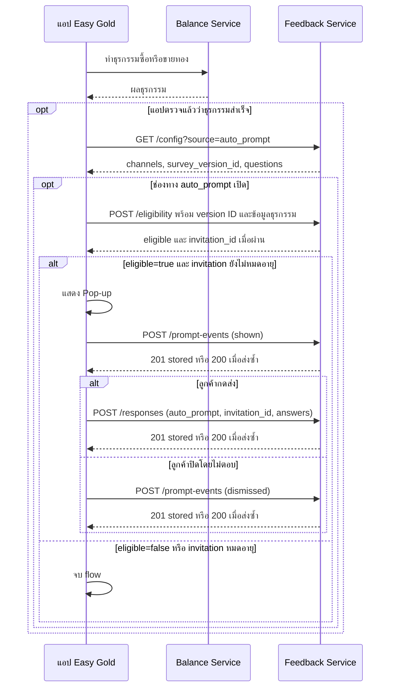
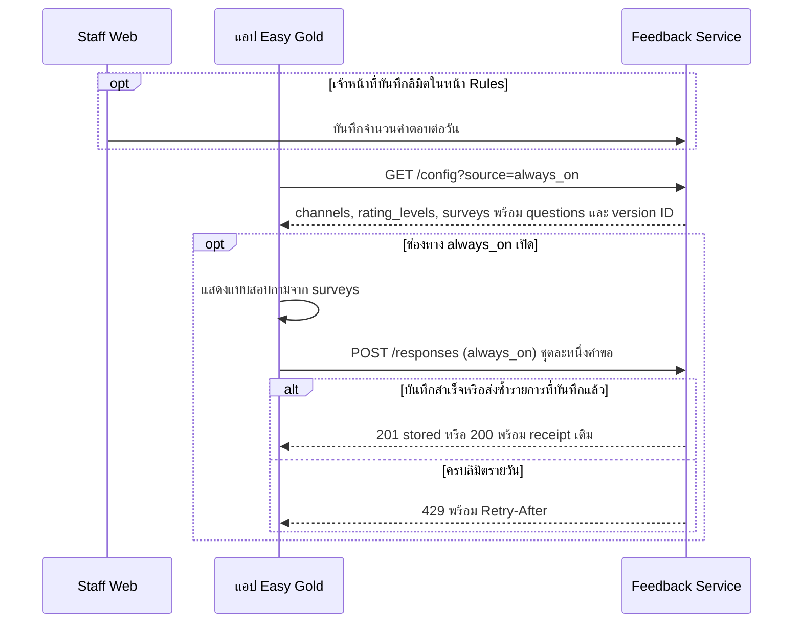

# คู่มือ API สำหรับแอป Easy Gold → Feedback Service

อัปเดต 23 พฤศจิกายน 2026

แอป Easy Gold เรียก Feedback Service โดยตรงด้วย Customer JWT เดิม ส่วน Balance Service ให้ผลธุรกรรมตาม flow การซื้อและขายทองของแอป

## 1. ภาพรวม

| จุดเริ่มต้น | ลำดับ API | เงื่อนไขหลัก |
|---|---|---|
| Pop-up หลังธุรกรรมสำเร็จ | Config → Eligibility → Prompt events → Responses หรือ Dismissed | ใช้แบบสอบถามหนึ่งชุดและ `invitation_id` ที่ผ่าน Eligibility |
| ลูกค้าเปิดหน้า Feedback | Config → Responses แยกตามแบบสอบถาม | ใช้ `surveys[]` และตรวจลิมิตรายวันตอนส่งคำตอบ |

### 1.1 Pop-up หลังธุรกรรมสำเร็จ (`auto_prompt`)



Feedback Service ยืนยันบัญชีลูกค้าจาก JWT และบันทึกข้อมูลธุรกรรมเป็น `client_reported` แอปต้องตรวจผลธุรกรรมก่อนขอ Eligibility เพราะขั้นตอนนี้ตรวจเฉพาะกฎการแสดง Pop-up ตามข้อมูลที่แอปรายงาน

### 1.2 หน้า Feedback (`always_on`)



หน้า Feedback เริ่มได้เมื่อผู้ใช้เปิดหน้า ข้อมูลที่ต้องใช้มาจาก Config ของ Feedback Service โดยช่องทางนี้ไม่ใช้ Eligibility, Prompt events หรือ invitation

## 2. Base URL และการยืนยันตัวตน

ตั้ง `feedback_base_url` เป็น URL ของ Feedback Service ถึงพอร์ตหรือ hostname ตัวอย่างนี้ใช้กับเครื่องที่รันบริการเองบนพอร์ต 8001

```text
feedback_base_url=http://127.0.0.1:8001
```

สำหรับมือถือหรือเครื่องอื่นใน Wi-Fi เดียวกัน ให้ใช้ IP ของ Mac และพอร์ตที่ Feedback Service เปิดจริง ใน Bruno ให้ใส่ `http://` หรือ `https://` ในค่าตัวแปรครั้งเดียว และใช้ `{{feedback_base_url}}/api/v1/feedback/...` ใน URL ของ request

ทุก request ต้องส่ง customer JWT เดิม:

```http
Authorization: Bearer <CUSTOMER_JWT>
Accept: application/json
```

ทุก POST ให้เพิ่ม:

```http
Content-Type: application/json
Idempotency-Key: <unique-key-for-this-operation>
```

Feedback Service ตรวจ JWT และอ่าน user ID จาก claim `_id` และตรวจว่า role เป็น `CUSTOMER` ไม่ต้องส่ง `actor_user_id` หรือ service token จากแอป ค่า user ID ใน body ไม่ถูกนำมาใช้แทน JWT

ฝั่งเซิร์ฟเวอร์ตั้ง `FEEDBACK_CUSTOMER_JWT_SECRET` ให้ตรวจลายเซ็น HS256 ของ Customer JWT ได้ แอปใช้เฉพาะ JWT ที่ได้รับจากการเข้าสู่ระบบ

**Idempotency:** การ retry operation เดิมให้ใช้ key และ payload เดิม การสร้าง operation ใหม่ให้ใช้ key ใหม่ แยก key ของ eligibility, event และ response ออกจากกัน Key ใช้อักษร ตัวเลข `.`, `_`, `:`, `-` ได้ ความยาว 1–128 ตัวอักษร หากใช้ key เดิมกับ payload ต่างกันอาจได้ `409 Conflict`

วันที่และเวลาที่ส่งใน body ใช้ UTC รูปแบบ `YYYY-MM-DDTHH:mm:ssZ` ไม่มีเศษวินาที และไม่อยู่ในอนาคต ตัวอย่างเวลาในเอกสารเป็นเพียงตัวอย่าง ต้องเปลี่ยนให้ตรงกับเหตุการณ์จริง

## 3. สรุป endpoints

| Method | Path | หน้าที่ |
|---|---|---|
| GET | `/config` | ดึงคำถามและการตั้งค่าของ survey ที่เผยแพร่แล้ว |
| POST | `/eligibility` | ตรวจนโยบาย Pop-up และสร้าง invitation เมื่อผ่านเงื่อนไข |
| POST | `/prompt-events` | บันทึกว่าแสดงหรือปิด Pop-up |
| POST | `/responses` | บันทึกคำตอบจาก Pop-up หรือหน้า Feedback |

## 4. GET `/config`

ทั้งสอง flow ใช้ `GET /config` เส้นเดิมและส่งเฉพาะ `source` เพื่อให้ Feedback Service เลือกแบบสอบถามจากเวอร์ชันที่เผยแพร่แล้ว

| Flow | รายการคำถาม | ตำแหน่ง `survey_version_id` |
|---|---|---|
| `auto_prompt` | `response.questions` จากแบบสอบถามล่าสุดหนึ่งชุดที่รองรับ Pop-up | `response.survey_version_id` |
| `always_on` | `response.surveys[index].questions` จากเวอร์ชันเผยแพร่ล่าสุดของแต่ละแบบสอบถามที่รองรับหน้า Feedback | `response.surveys[index].survey_version_id` ของชุดที่ลูกค้าตอบ |

| Query | จำเป็น | คำอธิบาย |
|---|---|---|
| `source` | ไม่ | ใช้ `auto_prompt` สำหรับ Pop-up หรือ `always_on` สำหรับหน้า Feedback ค่าเริ่มต้นคือ `always_on` |
| `survey_code` | ไม่ | ใช้เฉพาะเมื่อต้องการเลือกแบบสอบถามชุดใดชุดหนึ่ง ในกรณีนี้ `always_on` จะคืนข้อมูลชุดนั้นที่ระดับบนสุด |

### 4.1 Config ของ Pop-up

```http
GET /api/v1/feedback/config?source=auto_prompt
Authorization: Bearer <CUSTOMER_JWT>
Accept: application/json
```

ตัวอย่าง response บางส่วน; ฟิลด์และคำถามจริงขึ้นอยู่กับ survey และ rules ที่เผยแพร่:

```json
{
  "source": "auto_prompt",
  "survey_code": "demo-experience",
  "survey_version": 1,
  "survey_version_id": "11111111-1111-4111-8111-111111111111",
  "rating_levels": [5, 4, 3, 2, 1],
  "channels": {"auto_prompt": true, "always_on": true},
  "questions": [
    {"id": "22222222-2222-4222-8222-222222222222", "type": "rating"}
  ]
}
```

ตรวจ `channels.auto_prompt` ก่อนเรียก Eligibility และเก็บ `survey_version_id` พร้อมคำถามของชุดนี้ไว้จนจบ flow ระบบเลือกแบบสอบถามที่สร้างล่าสุดจากชุดที่มีเวอร์ชันเผยแพร่ล่าสุดรองรับ Pop-up และคืนเฉพาะคำถามชนิด `rating` ที่เปิดใช้งาน

### 4.2 Config ของหน้า Feedback

```http
GET /api/v1/feedback/config?source=always_on
Authorization: Bearer <CUSTOMER_JWT>
Accept: application/json
```

ตัวอย่าง response แบบย่อ

```json
{
  "source": "always_on",
  "survey_version_id": "11111111-1111-4111-8111-111111111111",
  "rating_levels": [5, 4, 3, 2, 1],
  "channels": {"auto_prompt": true, "always_on": true},
  "surveys": [
    {
      "survey_version_id": "11111111-1111-4111-8111-111111111111",
      "channels": {"auto_prompt": true, "always_on": true},
      "questions": [
        {"id": "22222222-2222-4222-8222-222222222222", "type": "rating", "required": true},
        {"id": "55555555-5555-4555-8555-555555555555", "type": "text", "required": false}
      ]
    },
    {
      "survey_version_id": "66666666-6666-4666-8666-666666666666",
      "channels": {"auto_prompt": false, "always_on": true},
      "questions": [
        {"id": "77777777-7777-4777-8777-777777777777", "type": "choice", "required": true}
      ]
    }
  ]
}
```

อ่าน `rating_levels` จากระดับบนสุดและสร้างแบบฟอร์มจาก `surveys[]` ครั้งเดียว ระดับบนสุดยังมีข้อมูลของแบบสอบถามล่าสุดสำหรับแอปเวอร์ชันเดิม เมื่อส่งคำตอบ ให้ใช้ `survey_version_id`, `questions[].id` และ option IDs จากรายการเดียวกัน ส่งแยกครั้งต่อแบบสอบถามด้วย `client_submission_id` และ `Idempotency-Key` ของตัวเอง

ตรวจ `channels.always_on` ก่อนเปิดให้ตอบ คำถามที่ส่งกลับมามีเฉพาะคำถามที่เปิดใช้งานในเวอร์ชันเผยแพร่แล้ว เช่น rating, choice และ text หากไม่มีแบบสอบถามที่เผยแพร่และรองรับ source ที่ขอ Config จะตอบ `404` ใช้ UUID จาก response จริงเมื่อทดสอบ

สวิตช์ **ເປີດໜ້າຄຳຄິດເຫັນ** จัดการที่ **Settings → Customer Service → แก้ไข** แล้วบันทึกร่างและเผยแพร่ เมื่อปิด Config จะส่ง `customer_service.enabled: false` และ `channels.always_on: false` ทั้งระดับบนสุดและแต่ละรายการใน `surveys[]` แอปต้องซ่อนหรือปิดทางเข้าหน้า Feedback และไม่เปิดให้ส่งคำตอบ Always-On โดย Pop-up หลังธุรกรรมยังใช้ `channels.auto_prompt` แยกกัน API ปฏิเสธคำตอบใหม่หลังปิด แม้ผู้ใช้เปิดฟอร์มค้างไว้ แต่ยังคืน receipt เดิมเมื่อ retry คำตอบที่บันทึกสำเร็จแล้ว Config ไม่ให้แคช (`Cache-Control: private, no-store`); แอปควรอ่าน Config ใหม่เมื่อกลับเข้าหน้าบริการ ไม่ใช้ค่าที่เก็บค้างในแอป

## 5. POST `/eligibility`

เรียกหลังแอปตรวจว่าธุรกรรมสำเร็จแล้ว เพื่อให้ Feedback ตรวจนโยบายของผู้ใช้และประเภทธุรกรรมนั้น ๆ

```http
POST /api/v1/feedback/eligibility
Authorization: Bearer <CUSTOMER_JWT>
Content-Type: application/json
Idempotency-Key: eligibility-buy-transaction-001
```

```json
{
  "survey_version_id": "11111111-1111-4111-8111-111111111111",
  "transaction_id": "transaction-001",
  "transaction_type": "BUY_GOLD",
  "transaction_occurred_at": "2026-11-19T08:00:00Z"
}
```

| ฟิลด์ | ความหมาย |
|---|---|
| `survey_version_id` | UUID ระดับบนสุดจาก `GET /config?source=auto_prompt` ที่โหลดคำถามชุดนี้ |
| `transaction_id` | ID ธุรกรรมจากแอป สูงสุด 100 ตัวอักษร |
| `transaction_type` | `BUY_GOLD` หรือ `SALE_GOLD` |
| `transaction_occurred_at` | เวลาธุรกรรมที่แอปรายงาน เป็น UTC และไม่อยู่ในอนาคต |

ตัวอย่างเมื่อผ่านและสร้าง invitation ใหม่ `201 Created`:

```json
{
  "eligible": true,
  "reason": null,
  "transaction_type": "BUY_GOLD",
  "successful_response_count": 0,
  "max_responses": 3,
  "remaining_responses": 3,
  "cooldown_days": 30,
  "cooldown_until": null,
  "reset_policy": "pending_confirmation",
  "invitation_id": "33333333-3333-4333-8333-333333333333",
  "survey_version_id": "11111111-1111-4111-8111-111111111111",
  "expires_at": "2026-11-20T08:00:00Z"
}
```

เก็บ `invitation_id` และ `expires_at` คู่กับ `survey_version_id` และคำถามชุดเดิม แสดง Pop-up เมื่อ `eligible=true` และ invitation ยังมีอายุ การ retry หรือ invitation ที่มีอยู่แล้วอาจตอบ `200 OK`

ตัวอย่างเมื่ออยู่ในช่วง cooldown (`200 OK`):

```json
{
  "eligible": false,
  "reason": "cooldown_active",
  "transaction_type": "BUY_GOLD",
  "successful_response_count": 1,
  "max_responses": 3,
  "remaining_responses": 2,
  "cooldown_days": 30,
  "cooldown_until": "2026-12-19T08:00:00Z",
  "reset_policy": "pending_confirmation"
}
```

| `reason` เมื่อ `eligible=false` | ความหมาย |
|---|---|
| `trigger_disabled` หรือ `outside_schedule` | กฎ Pop-up ปิดสำหรับธุรกรรมนี้ หรืออยู่นอกช่วงเวลา |
| `cooldown_active` | ยังไม่ถึง `cooldown_until` ของประเภทธุรกรรมนี้ |
| `response_limit_reached` | ส่งคำตอบสำเร็จครบโควตาของประเภทธุรกรรมนี้แล้ว |
| `invitation_expired` หรือ `invitation_answered` | invitation หมดอายุหรือมีคำตอบแล้ว |
| `evaluation_retry_requires_new_key` | การตรวจด้วย key เดิมเคยถูกปฏิเสธ หากต้องประเมินใหม่หลังเงื่อนไขเปลี่ยน ให้สร้าง key ใหม่ |

นโยบายปัจจุบันนับเฉพาะคำตอบ Pop-up ที่บันทึกสำเร็จ แยกตาม user และประเภทธุรกรรม สูงสุด 3 คำตอบต่อประเภท และหลังตอบแต่ละครั้งมี cooldown 30 วัน การปิด Pop-up โดยไม่ตอบไม่เพิ่มจำนวนคำตอบ การ reset หลังครบ 3 ครั้งยังเป็น `pending_confirmation` และโค้ดปัจจุบันยังไม่มีการ reset อัตโนมัติ

## 6. POST `/prompt-events`

เมื่อแสดง Pop-up ให้ส่ง `shown`; ถ้าลูกค้าปิดโดยไม่ตอบ ให้ส่ง `dismissed` เป็น event แยก โดยใช้ event ID และ idempotency key ใหม่ของแต่ละ event

```http
POST /api/v1/feedback/prompt-events
Authorization: Bearer <CUSTOMER_JWT>
Content-Type: application/json
Idempotency-Key: event-shown-001
```

```json
{
  "invitation_id": "33333333-3333-4333-8333-333333333333",
  "event_id": "event-shown-001",
  "event_type": "shown",
  "occurred_at": "2026-11-19T08:01:00Z"
}
```

`event_type` เป็น `shown` หรือ `dismissed` และ `occurred_at` ต้องอยู่ในช่วงอายุ invitation และไม่อยู่ในอนาคต

ตัวอย่าง `201 Created`; retry เดิมอาจได้ `200 OK`:

```json
{"event_id":"event-shown-001","status":"stored"}
```

## 7. POST `/responses`

ใช้ endpoint เดียวกันสำหรับ Pop-up และหน้า Feedback ตัวอย่างคำตอบเป็น rating อย่างเดียว; ต้องส่งคำถามที่บังคับ ตัวเลือก และเหตุผลให้ครบตาม config จริง

ไม่ต้องส่ง `name` และ `phone` ใน body ทั้ง `auto_prompt` และ `always_on` หากส่งสองฟิลด์นี้พร้อมค่าจะได้ `422` แอปส่ง Customer JWT เดิมใน Authorization โดย Feedback Service อ่าน `_id` เป็นเจ้าของคำตอบเสมอ

หลังตรวจลายเซ็น JWT แล้ว ระบบอ่าน `first_name` และ `last_name` เป็นชื่อแสดงผล และ `phone` เป็นเบอร์โทร เมื่อ claim เป็น string ในรูปแบบที่รองรับ ชื่อยาวไม่เกิน 200 ตัวอักษร เบอร์ยาวไม่เกิน 40 ตัวอักษร หากไม่มีข้อมูลหรือรูปแบบไม่ถูกต้อง จะบันทึกคำตอบโดยไม่มีฟิลด์โปรไฟล์นั้น ไม่ดึงค่าจาก body มาทดแทน

ชื่อและเบอร์จาก JWT เก็บแบบเข้ารหัสพร้อมคำตอบ และไม่คืนใน receipt การ retry ใช้ body กับ Idempotency-Key เดิมได้แม้ JWT ต่ออายุหรือข้อมูลโปรไฟล์ใน token เปลี่ยน โดยไม่แก้ข้อมูลคำตอบที่บันทึกไปแล้ว

หน้า Customers และ Feedback ยังคงแสดงคอลัมน์ชื่อและเบอร์โทรตามสิทธิ์ `customer_identity.read` หน้า Feedback แสดงข้อมูลจาก JWT ที่บันทึกพร้อมคำตอบแต่ละรายการ หน้า Customers ใช้ชื่อและเบอร์ล่าสุดที่บันทึกสำเร็จของ User ID เดียวกันก่อน หากไม่มีฟิลด์นั้นจึงใช้ข้อมูลที่ซิงก์จาก User Service การรับ GET config อย่างเดียวไม่บันทึกโปรไฟล์ ต้องส่งคำตอบสำเร็จก่อน การบันทึกข้อมูลโปรไฟล์จาก JWT ไม่ทำให้ cohort snapshot กลายเป็น complete ข้อมูลเก่าที่เคยรับจาก body ยังคงอยู่ หากไม่มีข้อมูลโปรไฟล์ที่ใช้ได้จะแสดง `—`

### 7.1 คำตอบจาก Pop-up

```http
POST /api/v1/feedback/responses
Authorization: Bearer <CUSTOMER_JWT>
Content-Type: application/json
Idempotency-Key: response-popup-001
```

```json
{
  "client_submission_id": "submission-popup-001",
  "survey_version_id": "11111111-1111-4111-8111-111111111111",
  "source": "auto_prompt",
  "invitation_id": "33333333-3333-4333-8333-333333333333",
  "submitted_at": "2026-11-19T08:02:00Z",
  "answers": [
    {"question_id": "22222222-2222-4222-8222-222222222222", "rating_value": 5}
  ],
  "metadata": {"app_version": "1.0.0", "os": "android"}
}
```

Pop-up ต้องใช้ invitation ที่เป็นของผู้ใช้ใน JWT และยังมีอายุอยู่ `rating_value` เป็นจำนวนเต็ม 1–5; ถ้าคำถามเปิดใช้และบังคับเหตุผล ต้องส่ง `option_ids` ที่ตรงกับคะแนนจาก config เพิ่มเติม คำถาม rating ของ Pop-up อาจส่ง `text_value` เป็นคำแนะนำเพิ่มเติมตามข้อจำกัดความยาวใน config

### 7.2 คำตอบจากหน้า Feedback

ใช้ `survey_version_id` และคำถามจากรายการเดียวกันใน `surveys[]` ส่งหนึ่ง request ต่อแบบสอบถาม โดยละ `invitation_id` และข้อมูลธุรกรรม

```http
POST /api/v1/feedback/responses
Authorization: Bearer <CUSTOMER_JWT>
Content-Type: application/json
Idempotency-Key: response-page-001
```

```json
{
  "client_submission_id": "submission-page-001",
  "survey_version_id": "11111111-1111-4111-8111-111111111111",
  "source": "always_on",
  "submitted_at": "2026-11-19T08:03:00Z",
  "answers": [
    {"question_id": "22222222-2222-4222-8222-222222222222", "rating_value": 4},
    {"question_id": "55555555-5555-4555-8555-555555555555", "text_value": "อยากให้เพิ่มตัวกรองในประวัติธุรกรรม"}
  ],
  "metadata": {"app_version": "1.0.0", "os": "ios"}
}
```

| ชนิดคำถาม | ฟิลด์คำตอบ |
|---|---|
| `rating` | `question_id` และ `rating_value` เป็นจำนวนเต็ม 1–5 เพิ่ม `option_ids` จากเหตุผลของคะแนนนั้นตามการตั้งค่าคำถาม |
| `choice` | `question_id` และ `option_ids` ของคำถามเดียวกัน ตามจำนวนที่ `max_choices` อนุญาต |
| `text` | `question_id` และ `text_value` ตาม `max_length` ของคำถาม |

ส่งคำถามที่ `required=true` ให้ครบ หากหน้า Feedback มีความคิดเห็นเพิ่มเติม ให้ส่งผ่านคำถามชนิด `text` เป็นรายการแยก ฟิลด์ `metadata` ไม่บังคับ และ `os` รองรับ `android`, `ios`, `other`

ตัวอย่าง response เมื่อบันทึกใหม่ (`201 Created`):

```json
{
  "response_id": "44444444-4444-4444-8444-444444444444",
  "client_submission_id": "submission-page-001",
  "status": "stored",
  "received_at": "2026-11-19T08:03:01Z"
}
```

Retry คำตอบเดิมด้วย key และ payload เดิมอาจได้รับ `200 OK` พร้อม receipt เดิม สำหรับคำตอบใหม่ให้สร้าง `client_submission_id` และ idempotency key ใหม่

### 7.3 ลิมิตรายวันของหน้า Feedback

เจ้าหน้าที่ตั้งค่าใน **Rules → ກຳນົດລິມີດການຕອບຂອງລູກຄ້າ** ฟอร์มเสนอ `3` ครั้งต่อวันก่อนตั้งค่าครั้งแรก และค่าที่บันทึกมีผลทันที

- Feedback Service นับคำตอบ `always_on` ที่บันทึกสำเร็จรวมทุกแบบสอบถามต่อบัญชี โดยใช้เวลารับคำตอบของเซิร์ฟเวอร์ รอบใหม่เริ่มตอน 00:00 น. เขตเวลา `Asia/Vientiane`
- เมื่อครบลิมิต `POST /responses` ตอบ `429` พร้อม `Retry-After` เป็นจำนวนวินาทีจนถึงเที่ยงคืน รายการที่เคยบันทึกสำเร็จและส่งซ้ำด้วยข้อมูลเดิมยังได้ receipt เดิม
- ลิมิตรายวันตรวจตอนส่งคำตอบ แอปอ่านจำนวนคงเหลือจาก Config ไม่ได้ ส่วนการจำกัดอัตราส่งทั่วไปอาจตอบ `429` ด้วยข้อความและเวลารอของกฎนั้น

ตัวอย่างเมื่อครบลิมิตก่อนเที่ยงคืน 1 นาที

```http
HTTP/1.1 429 Too Many Requests
Retry-After: 60
Content-Type: application/json
```

```json
{
  "message": "Daily feedback limit reached."
}
```

## 8. การจัดการข้อผิดพลาด

| HTTP | ความหมายที่พบบ่อย |
|---|---|
| 401 | JWT ไม่มี ไม่ถูกต้อง หรือหมดอายุ |
| 403 | JWT ไม่ใช่ role `CUSTOMER` |
| 404 | ไม่พบ survey ที่เผยแพร่ หรือ resource ที่เข้าถึงได้ |
| 409 | key, event หรือ submission ID ซ้ำแต่ payload ต่างกัน หรือ invitation ถูกตอบแล้ว |
| 413 | request ใหญ่เกินกำหนด |
| 422 | ข้อมูลไม่ครบ คำตอบไม่ตรง Config ช่องทางถูกปิด หรือ invitation ใช้ไม่ได้ |
| 429 | เกินอัตราส่งหรือครบจำนวนคำตอบจากหน้า Feedback ต่อบัญชีในวันนั้น กรณีครบจำนวนต่อวัน `Retry-After` ระบุวินาทีจนถึงเที่ยงคืนเวลาเวียงจันทน์ |
| 503 | ยังไม่ได้ตั้ง customer JWT secret หรือ service ไม่พร้อม |

ให้ใช้ HTTP status เป็นหลักและอ่านรายละเอียดจาก JSON body สำหรับ `429` ให้ใช้ `Retry-After` หากมี ส่วน timeout หรือ `5xx` ให้ retry ด้วย ID, key, body และเวลาเดิม เพราะคำตอบอาจบันทึกสำเร็จแล้ว

## 9. วิธีทดสอบด้วย Postman หรือ Bruno

1. ใน Bruno เลือก environment เช่น `Local integration` แล้วตั้ง `feedback_base_url` และ `customer_token` ของบัญชีทดสอบ สำหรับ Postman ให้ตั้ง base URL, Bearer Token และ `Accept: application/json` ตามหัวข้อ 2
2. ทดสอบ Pop-up ด้วย **01 Get popup config → 02 Check transaction eligibility → 03 Record popup shown → 04 Submit popup feedback** ใช้ข้อมูลธุรกรรมทดสอบที่สำเร็จ และไปต่อเมื่อ `eligible=true` หากทดสอบกดปิด ให้ใช้ **07 Record popup dismissed** แทนการส่งคำตอบ
3. ทดสอบหน้า Feedback ด้วย **05 Get always-on config → 06 Submit always-on feedback** สคริปต์ Bruno เก็บ ID ของแบบสอบถามล่าสุดกับคำถาม rating แรก ถ้าจะทดสอบชุดอื่น ให้ใช้ version ID และ question IDs จากรายการเดียวกันใน `surveys[]` และปรับ `answers` ให้ครบตาม Config
4. ทดสอบลิมิตรายวันด้วยลิมิตที่บันทึกไว้ใน Rules เมื่อบัญชีทดสอบส่งคำตอบสำเร็จครบจำนวนแล้ว คำขอใหม่จะได้ `429` และการ retry คำตอบเดิมด้วย key และ payload เดิมจะได้ `200`
5. คำตอบและ event จะบันทึกในฐานข้อมูลของ environment ที่เรียก การทดสอบรายการใหม่ใช้ IDs และ keys ใหม่

ชุดคำขอ Bruno พร้อมตัวแปรและลำดับทดสอบ [04 App Feedback Direct](../../bruno/EasyGold-Feedback/04%20App%20Feedback%20Direct/README.md)
